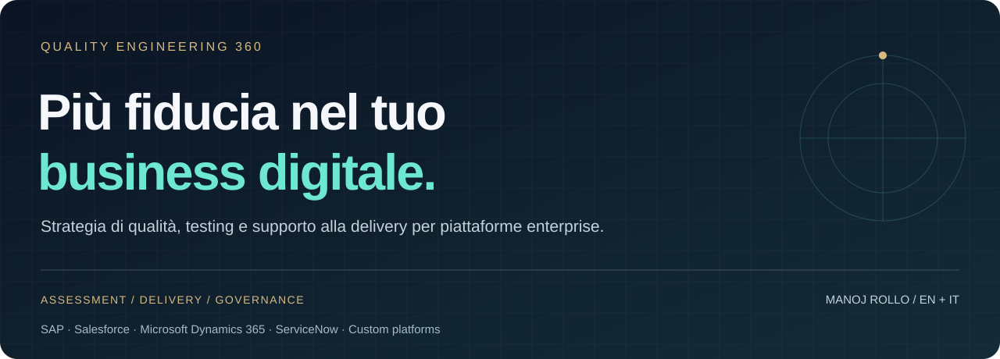

**[English](README.md) · [Italiano](README.it.md)** &nbsp; | &nbsp; **[Parliamo della tua sfida →](CONTACT.md#italiano)**

Il percorso del tuo cliente attraversa più applicazioni. La strategia di qualità deve seguire l'intero percorso.

**Quality Engineering 360** presenta servizi di consulenza e collaborazione per organizzazioni che gestiscono prodotti digitali interconnessi, piattaforme enterprise e processi critici. Si rivolge a responsabili tecnologia, prodotto, operations e trasformazione, ma anche a system integrator e team software che cercano un partner per la delivery QA.

**Partire dal problema di business. Concordare le evidenze necessarie. Costruire il giusto perimetro di intervento.**

## Quando vale la pena confrontarsi

| Cosa stai osservando | Dove può concentrarsi il supporto | Cosa puoi usare per decidere |
| --- | --- | --- |
| I rilasci slittano o richiedono continui interventi urgenti | Rischi di rilascio, perimetro di regressione e analisi dei difetti | Una vista dei rischi con priorità, responsabilità e sintesi di readiness |
| SAP, CRM e applicazioni custom funzionano singolarmente, ma il processo si interrompe tra sistemi | Validazione di processi end-to-end, API, integrazioni e dati | Una vista condivisa della copertura e dei passaggi critici |
| L'automazione cresce, ma la fiducia nei risultati non migliora | Affidabilità delle suite, architettura, manutenzione e feedback CI/CD | Un backlog di cosa mantenere, migliorare o dismettere, legato ai rischi di business |
| I picchi di domanda rendono i servizi lenti o instabili | Modello di carico, test distribuiti e analisi dei colli di bottiglia | Evidenze di performance rispetto a carichi e obiettivi concordati |
| Team e fornitori producono report di qualità poco confrontabili | Governance QA, test management e criteri comuni di rilascio | Report confrontabili, responsabilità decisionali e rischi residui |
| Una funzionalità AI convince in demo ma si comporta in modo incostante | Scenari di valutazione, analisi degli errori e disegno del monitoraggio | Una baseline di valutazione revisionata e criteri di escalation umana |

## QA lungo tutto il ciclo di delivery

| Area di servizio | Perimetro e risultati tipici, concordati per ogni incarico |
| --- | --- |
| **Strategia di qualità e assessment** | Confronto con gli stakeholder, analisi di rischi e copertura, obiettivi di qualità e roadmap di miglioramento prioritizzata |
| **Testing funzionale, esplorativo e di regressione** | Scenari di business, progettazione ed esecuzione dei test, difetti riproducibili e copertura di regressione basata su evidenze |
| **Testing API, integrazioni e dati** | Contratti dei servizi, flussi tra sistemi, verifiche di riconciliazione e scenari di errore delle interfacce |
| **Test automation web e mobile** | Disegno di framework e suite, stabilizzazione dell'esistente, esecuzione in CI/CD e reporting manutenibile |
| **Performance, carico e resilienza** | Carichi rappresentativi, esecuzione distribuita, scenari di guasto concordati e analisi congiunta dei colli di bottiglia |
| **Validazione di piattaforme enterprise** | Modifiche ERP/CRM, aggiornamenti, integrazioni e regressione dei processi critici |
| **UAT, migrazioni e preparazione al rilascio** | Supporto all'accettazione business, evidenze di migrazione e riconciliazione, triage difetti e sintesi per decidere sul rilascio |
| **Accessibilità ed esperienza digitale** | Valutazioni mirate con tastiera, tecnologie assistive e percorsi utente, con gli specialisti adeguati |
| **Qualità e valutazione dell'AI** | Dataset di scenari, criteri di qualità degli output, casi avversi, valutazione di regressione e revisione umana |
| **Test management, governance e formazione** | Coordinamento di team e fornitori, reporting di qualità, pianificazione della delivery e trasferimento di competenze |

Le attività specialistiche e la composizione del team si confermano in fase di definizione del perimetro. Accessibilità, resilienza e valutazione AI richiedono interventi calibrati sul contesto; certificazioni, penetration test e pareri normativi richiedono un ambito qualificato separato.

## Pensato per la complessità enterprise

**Piattaforme:** SAP · Salesforce · Microsoft Dynamics 365 · ServiceNow · ERP/CRM custom e applicazioni digitali.

**Processi:** order-to-cash, procure-to-pay, record-to-report, lead-to-service, commercio digitale e self-service del cliente. Processi e versioni delle piattaforme rilevanti si concordano con i tuoi team.

**Contesto di delivery:** più gruppi di sviluppo, fornitori interni ed esterni, ambienti condivisi, servizi distribuiti, dipendenze tra rilasci e stakeholder business che devono prendere una decisione chiara.

Possiamo definire un intervento trasversale alle piattaforme insieme ai team engineering, prodotto e operations già presenti, con responsabilità e reporting espliciti. I nomi delle piattaforme descrivono l'ambito di confronto e non implicano certificazioni o partnership con i vendor.

## Scegliere da dove partire

| Collaborazione | Quando è utile | Risultati concordati |
| --- | --- | --- |
| **Assessment mirato** | Serve capire il principale vincolo di qualità prima di investire | Analisi delle evidenze, mappa dei rischi e prossimi passi prioritizzati |
| **Intervento specialistico di delivery** | Un rilascio, un'integrazione, l'automazione o le performance richiedono supporto operativo | Asset di test nel perimetro, risultati, report e passaggio di consegne |
| **Quality leadership integrata nel team** | Occorrono coordinamento continuativo e decisioni di rilascio più chiare | Piano di qualità, cadenza operativa, reporting condiviso e affiancamento |
| **Partnership B2B di delivery** | Un system integrator o un team software cerca competenze QA complementari | Interfacce, responsabilità, copertura specialistica e modello di collaborazione |
| **Programma continuativo di qualità** | Più prodotti o fornitori richiedono un approccio coerente | Roadmap progressiva, misure concordate e revisioni periodiche delle evidenze |

Perimetro, persone, accessi, deliverable, tempi e condizioni commerciali si concordano prima dell'avvio. [Leggi la guida alla collaborazione](docs/COLLABORATION.md#italiano).

## L'esperienza alla base del confronto

**Manoj Rollo** è Senior Digital Test Engineer / Senior Consultant in **Concept Quality Reply**, con focus su Digital Products & Platforms e **oltre 11 anni di esperienza nel digitale**, di cui **oltre 6 nel testing software**, preceduti da un percorso in **sviluppo, design e comunicazione digitale**.

Il suo percorso professionale pubblico comprende automazione cross-platform, test di carico distribuiti con **JMeter**, **API testing**, suite **Selenium** e **Appium** integrate in CI/CD e coordinamento di team e commesse. Il focus attuale sulle piattaforme enterprise include SAP, Salesforce, Dynamics 365 e ServiceNow.

Il portfolio unisce questa esperienza operativa a un'offerta più ampia, componibile con gli specialisti pertinenti. Non implica che ogni attività venga svolta da una sola persona né che il datore di lavoro abbia approvato questa repository.

**[Profilo professionale e contatto LinkedIn →](https://www.linkedin.com/in/manoj-rollo/)** · [Profilo GitHub](https://github.com/mr-jonam) · [Fonti e attribuzioni](docs/SOURCES.md)

## Rendere concreto il primo confronto

Invia una breve introduzione senza informazioni riservate:

> Gestiamo [piattaforme / tipo di prodotto]. Il problema principale è [sintomo]. Coinvolge [processo di business / team]. La prossima decisione è [rilascio / investimento / scelta del fornitore]. Vorremmo confrontarci su [assessment / supporto operativo / partnership].

**[Contatta Manoj su LinkedIn →](https://www.linkedin.com/in/manoj-rollo/)** · [Traccia di contatto bilingue](CONTACT.md)

Stai già approfondendo il problema internamente? Usa [Digital Quality Compass](https://github.com/mr-jonam/digital-quality-compass) per un primo orientamento. Per un esempio concreto leggi il [brief di collaborazione fittizio](examples/ENGAGEMENT-BRIEF.md#italiano).

## Questa repository

È un **portfolio di servizi** curato personalmente, con descrizioni pubbliche dell'offerta e risultati esemplificativi. Asset di delivery, evidenze dei clienti e metodi proprietari non sono pubblicati qui. Non serve installare software, creare account o avviare assessment automatici.

Per un collega: **[condividi il portfolio in italiano](https://github.com/mr-jonam/quality-engineering-360/blob/main/README.it.md)** o la sua [versione inglese](https://github.com/mr-jonam/quality-engineering-360).

© 2026 Manoj Rollo. **Tutti i diritti riservati.** Testi e grafica originali sono leggibili pubblicamente e non sono open source. [LICENSE](LICENSE) · [NOTICE](NOTICE). Restano possibili visualizzazione e fork secondo i termini GitHub. Le condizioni degli incarichi sono separate dai permessi sui contenuti della repository.
