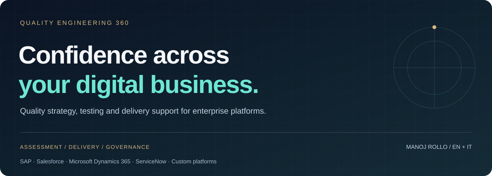

**[English](README.md) · [Italiano](README.it.md)** &nbsp; | &nbsp; **[Discuss your challenge →](CONTACT.md#english)**

Your customer journey does not stop at the edge of one application. Your quality strategy should cover the whole journey.

**Quality Engineering 360** presents consulting and collaboration services for organisations running interconnected digital products, enterprise platforms and business-critical processes. It is designed for technology, product, operations and transformation leaders, as well as system integrators and software teams seeking a QA delivery partner.

**Start with the business problem. Agree the evidence needed. Build the right delivery scope.**

## When a conversation is worth having

| What you are seeing | Where support can focus | What you can use to decide |
| --- | --- | --- |
| Releases slip or require repeated emergency fixes | Release-risk assessment, regression scope and defect analysis | A prioritised risk view, ownership and a release-readiness brief |
| SAP, CRM and custom applications pass in isolation, but the process breaks between them | End-to-end process, API, integration and data validation | A shared view of journey coverage and critical handoffs |
| Automation grows while confidence stays flat | Suite reliability, architecture, maintenance and CI/CD feedback | A retain / improve / retire backlog tied to business risk |
| Peak demand exposes slow or unstable services | Workload modelling, distributed load tests and bottleneck investigation | Performance evidence against agreed workloads and targets |
| Several teams or suppliers use incompatible quality reports | QA governance, test management and common release criteria | Comparable reporting, decision responsibilities and residual risks |
| An AI feature works in demos but behaves inconsistently | Evaluation scenarios, failure analysis and monitoring design | A reviewed evaluation baseline and human escalation criteria |

## QA across the delivery lifecycle

| Service area | Typical scope and outputs, agreed for each engagement |
| --- | --- |
| **Quality strategy & assessment** | Stakeholder discovery, risk and coverage review, quality objectives and a prioritised improvement roadmap |
| **Functional, exploratory & regression testing** | Business scenarios, test design and execution, reproducible findings and evidence-led regression coverage |
| **API, integration & data testing** | Service contracts, cross-system workflows, reconciliation checks and interface failure scenarios |
| **Web & mobile test automation** | Framework and suite design, existing-suite stabilisation, execution in CI/CD and maintainable reporting |
| **Performance, load & resilience testing** | Representative workloads, distributed test execution, agreed failure scenarios and joint bottleneck analysis |
| **Enterprise platform validation** | ERP/CRM changes, upgrades, integrations and critical business-process regression |
| **UAT, migration & release readiness** | Business acceptance support, migration/reconciliation evidence, defect triage and release decision packs |
| **Accessibility & digital experience** | Scoped keyboard, assistive-technology and user-journey evaluation with suitable specialists |
| **AI quality & evaluation** | Scenario datasets, output-quality criteria, adverse cases, regression evaluation and human review |
| **Test management, governance & enablement** | Team and supplier coordination, quality reporting, delivery planning and knowledge transfer |

Specialist workstreams and team composition are confirmed during scoping. Accessibility evaluation, resilience work and AI evaluation are tailored activities; certification, penetration testing and regulatory opinions require their own qualified scope.

## Built around enterprise complexity

**Platforms:** SAP · Salesforce · Microsoft Dynamics 365 · ServiceNow · custom ERP/CRM and digital applications.

**Journeys:** order-to-cash, procure-to-pay, record-to-report, lead-to-service, digital commerce and customer self-service. The relevant processes and platform versions are agreed with your teams.

**Delivery context:** multiple development squads, internal and external suppliers, shared environments, distributed services, release dependencies and business stakeholders who need a clear decision.

We can shape a cross-platform workstream around your existing engineering, product and operations teams, with explicit responsibilities and reporting. Platform names describe the scope we can discuss; they do not imply vendor certification or partnership.

## Choose a starting point

| Engagement | A useful fit | Agreed outputs |
| --- | --- | --- |
| **Focused assessment** | You need to understand the main quality constraint before investing | Evidence review, risk map and prioritised next steps |
| **Targeted delivery workstream** | A release, integration, automation or performance problem needs hands-on support | Scoped test assets, findings, reporting and handover |
| **Embedded quality leadership** | Teams need sustained coordination and clearer release decisions | Quality plan, delivery cadence, shared reporting and coaching |
| **B2B delivery partnership** | A system integrator or software team needs complementary QA capabilities | Defined interfaces, responsibilities, specialist coverage and a collaboration model |
| **Ongoing quality programme** | Several products or suppliers need a consistent approach | A phased roadmap, agreed measures and regular evidence reviews |

Scope, staffing, access, deliverables, timing and commercial arrangements are agreed before work begins. [See the collaboration guide](docs/COLLABORATION.md#english).

## The experience behind the conversation

**Manoj Rollo** is a Senior Digital Test Engineer / Senior Consultant at **Concept Quality Reply**, focused on Digital Products & Platforms, with **11+ years of professional experience**.

His published professional background includes cross-platform automation, distributed **JMeter** load testing, **API testing**, **Selenium** and **Appium** suites integrated into CI/CD, plus coordination of teams and delivery engagements. His current enterprise-platform focus includes SAP, Salesforce, Dynamics 365 and ServiceNow.

This portfolio combines that hands-on background with a wider service scope that can be assembled with the relevant specialists. It does not imply that every service is delivered by one person or that an employer has endorsed this repository.

**[Professional profile and contact on LinkedIn →](https://www.linkedin.com/in/manoj-rollo/)** · [GitHub profile](https://github.com/mr-jonam) · [Sources and attribution](docs/SOURCES.md)

## Make the first conversation concrete

Send a short, non-confidential introduction:

> We run [platforms / product type]. The main problem is [symptom]. It affects [business process / teams]. Our next decision is [release / investment / supplier choice]. We would like to discuss [assessment / delivery support / partnership].

**[Contact Manoj on LinkedIn →](https://www.linkedin.com/in/manoj-rollo/)** · [Bilingual contact brief](CONTACT.md)

Already exploring the problem internally? Use [Digital Quality Compass](https://github.com/mr-jonam/digital-quality-compass) for a first orientation. For a concrete conversation example, read the [fictional engagement brief](examples/ENGAGEMENT-BRIEF.md#english).

## About this repository

This is a personally maintained **service portfolio**, with public descriptions of services and illustrative outputs. Delivery assets, client evidence and proprietary methods are not published here. There is no software to install, account to create or automated assessment to run.

For a colleague: **[share the service portfolio](https://github.com/mr-jonam/quality-engineering-360)** or its [Italian version](https://github.com/mr-jonam/quality-engineering-360/blob/main/README.it.md).

© 2026 Manoj Rollo. **All rights reserved.** Original text and artwork are publicly readable, not open source. [LICENSE](LICENSE) · [NOTICE](NOTICE). Viewing and forking under GitHub's terms remain possible. Commercial engagement terms are separate from repository permissions.
